# naverblog-mcp


Google Drive에 올린 사진과 영상으로 Claude가 네이버 블로그 글을 쓰고, **임시저장**까지 해 주는 로컬 MCP 서버입니다.
Claude Desktop에 연결해서 "11월 14일에 다녀온 젠스시 사진으로 써줘"처럼 말하면 됩니다. 발행은 사람이 직접 합니다.

- 🔐 비밀번호를 저장하지 않습니다. 브라우저 창에서 한 번 로그인하면 그 쿠키를 재사용합니다.
- 👀 브라우저 작업(내 글과 같은 장소 리뷰 읽기, 장소 검색, 글 입력)이 모두 화면에 보이는 크롬 창에서 진행됩니다.
- 🧑‍🍳 네이버 맛집, 여행 상위 블로그 48편을 분석한 형식으로 씁니다: 한 줄 한 호흡, 가운데 정렬, 이모지 적극 사용, 짧은 소제목, 지도와 정보 줄은 글 앞쪽.
- ✍️ 맛 평가, 메뉴 설명, 느낀 점은 비워 두고 `[이 부분에 직접 입력하시기 바랍니다]`와 고를 수 있는 추천 문구를 남깁니다.
- 🤝 메인 에이전트는 Claude(자료 수집, 판단, 조립, 저장), 글을 쓰는 서브 에이전트는 선택입니다(`DRAFT_WRITER=claude` 기본, `gemini`로 바꾸면 Gemini가 제목과 문안만 씀). 두 작성자는 같은 집필 자료 묶음을 받습니다.
- ⏱️ 저장처럼 오래 걸리는 작업은 접수 번호를 바로 돌려주고 짧게 나눠 조회합니다. Claude Desktop의 도구 대기 시간(약 80초)을 넘기지 않습니다.
- 🛑 발행 버튼은 코드에서 막혀 있습니다. 결과물은 항상 임시저장입니다.

<br>

## 동작 흐름

**메인 에이전트 Claude**가 자료를 모으고 판단하고 조립합니다. **서브 에이전트 Gemini**는 글(제목과 문안)만 씁니다. 실제 파일, 브라우저, 네이버 작업은 모두 **로컬 MCP 서버**가 합니다.

### 구성도

MCP 공식 문서의 **호스트 → 서버 → 외부 자원** 배치에, 멀티 에이전트 문서에서 흔히 쓰는 **오케스트레이터(메인) → 워커(서브)** 구분과 번호 붙인 단계를 합쳐 한 장으로 그렸습니다. 가운데 서버 상자 안의 ①~⑥이 Claude가 부르는 도구 순서입니다.

```mermaid
flowchart LR
    U(["👤 사용자<br/>'11월 14일 젠스시<br/>사진으로 써줘'"])

    subgraph HOST["🖥️ Claude Desktop · MCP 호스트"]
        CL["🧠 <b>메인 에이전트 · Claude</b><br/>오케스트레이터<br/>───────────<br/>도구 호출 순서 · 확인 질문<br/>사실 대조 · 첨부 조립"]
    end

    subgraph SRV["🧰 로컬 MCP 서버 · naver-blog-writer · stdio"]
        direction TB
        S1["<b>① 가이드 준비</b><br/>get_style_guide → writing_ref<br/>내 글 5편 · 최신 경향 · 기본 가이드"]
        S2["<b>② 자료 수집</b> · guide_ref<br/>list_folders → scan_media<br/>view_images · extract_video_frames<br/>find_place → place_reviews<br/>load_research · my_post_links"]
        S3["<b>③ 집필 자료 확정</b><br/>prepare_writing_packet → packet_id<br/>요청 · 메모 · 사실 · 본 JPEG 그대로<br/>gemini 모드면 여기서 Gemini 작성 시작"]
        S4{"<b>④ 작성자</b><br/>DRAFT_WRITER"}
        S4A["claude<br/>read_writing_packet"]
        S4B["gemini<br/>⏳ gemini_draft_status<br/>Claude는 쓰지 않음"]
        S5["<b>⑤ 조립 · 점검</b><br/>write_post · dry_run · packet_id<br/>작성자 확인 · lint · 겹침 · 사진 순서"]
        S6["<b>⑥ 임시저장</b><br/>write_post → job_id 1초 안에<br/>⏳ draft_status → saved"]
        S1 --> S2 --> S3 --> S4
        S4 -->|claude| S4A --> S5
        S4 -->|gemini| S4B --> S5
        S4B -.->|"failed면 Claude가 직접"| S4A
        S5 --> S6
    end

    subgraph WORKER["✍️ 서브 에이전트 · 워커"]
        GM["<b>Gemini 4 Neon High</b><br/>agy acp · 샌드박스<br/>도구 권한 없음<br/>제목 · 문안만 작성"]
    end

    subgraph EXT["🌍 외부 자원"]
        DRV[("📁 Google Drive<br/>사진 · 영상 폴더")]
        NV[("🌐 네이버<br/>블로그 · 지도 · 에디터")]
    end

    U <-->|"요청 · 확인 질문 · 결과"| CL
    CL <-->|"MCP 도구 호출 ①→⑥"| SRV
    S2 -.->|"MEDIA_ROOTS 안만 읽기"| DRV
    S1 -.->|"크롬 창 · 공개 글 읽기"| NV
    S2 -.->|"장소 검색 · 같은 장소 리뷰"| NV
    S4B <-->|"같은 텍스트 + JPEG ⇄ 제목 · 문안 JSON"| GM
    S6 ==>|"크롬 창 · 임시저장만 · 발행 차단"| NV

    classDef user fill:#FFF4D6,stroke:#E0A800,color:#5C4400
    classDef claude fill:#E8F1FF,stroke:#3B82F6,color:#1E3A8A
    classDef gemini fill:#F3E8FF,stroke:#9333EA,color:#581C87
    classDef step fill:#F8FAFC,stroke:#64748B,color:#1E293B
    classDef job fill:#FEF2F2,stroke:#EF4444,color:#7F1D1D
    classDef ext fill:#ECFDF5,stroke:#10B981,color:#064E3B
    class U user
    class CL,S4A claude
    class GM,S4B gemini
    class S1,S2,S3,S4,S5 step
    class S6 job
    class DRV,NV ext
```



| 단계 | Claude가 부르는 도구 | 결과 |
|---|---|---|
| ① 가이드 준비 | `get_style_guide(topic)` | 전체 가이드, 이번 글의 자료 번호 `writing_ref`, 작성자 `draft_writer` |
| ② 자료 수집 | `list_folders` → `scan_media` → `view_images` · `extract_video_frames` → `find_place` → `place_reviews` (→ `load_research` · `my_post_links`) | 폴더 확인 질문, 촬영 시각순 목록, Claude가 본 JPEG, 장소 ID, 같은 장소 리뷰 분석. 모두 `guide_ref`로 이번 글 자료에 모임 |
| ③ 자료 확정 | `prepare_writing_packet(brief)` | `packet_id`: 두 작성자가 똑같이 받는 텍스트와 이미지. gemini 모드면 이 호출이 Gemini 작성을 바로 시작하고 `generation_id`를 돌려줌 |
| ④ 문안 | claude: `read_writing_packet` / gemini: `gemini_draft_status`로 조회만 | 제목과 자리별 문안. gemini 모드에서 `read_writing_packet`은 Gemini가 `failed`일 때만 열림 |
| ⑤ 점검 | `write_post(dry_run=true, packet_id)` | 말투, 겹침, 사진 순서 경고와 작성자 `writer`. gemini 모드에서 Gemini 결과가 없으면 거부. 고친 최종본만 다음 단계로 |
| ⑥ 임시저장 | `write_post` → `draft_status(job_id)` | 1초 안에 접수, 조회로 진행 단계 확인, `saved`일 때만 성공 |

| 누가 | 하는 일 | 하지 않는 일 |
|---|---|---|
| 🧠 Claude (메인) | 도구 호출 순서, 폴더와 장소 확인 질문, 자료 확정, 사실 대조, 사진·영상·지도·링크 조립, 점검과 저장 확인 | Gemini 모드에서 문안을 대신 쓰지 않음(`write_post`가 `packet_id`의 Gemini 결과를 확인하고, 없으면 거부) |
| ✍️ Gemini (서브) | 확정된 자료 묶음(Claude와 같은 텍스트, 같은 JPEG)으로 제목과 자리별 문안 작성 | 검색, 파일 읽기, 도구 호출, 저장, 재시도 |
| 🧰 MCP 서버 | 파일 읽기, 축소 이미지, 네이버 지도·리뷰 읽기, 에디터 입력, 저장 작업과 상태 기록 | 이미지 인식, 발행 |

- 오래 걸리는 두 작업(Gemini 문안 생성, 네이버 임시저장)은 **접수 → 조회**로 나눕니다. 도구 호출 하나가 길어져 Claude Desktop이 응답 없음으로 끊는 일을 막기 위해서입니다. 접수는 1초 안에 돌아오고, 조회는 한 번에 10초까지만 기다립니다.
- `DRAFT_WRITER=claude`면 ④에서 Claude가 같은 자료 묶음을 읽고 직접 씁니다. 나머지 단계는 같습니다.

<br>

## 빠른 시작 (macOS)

미리 설치해 둘 것: [Google Chrome](https://www.google.com/chrome/), [Google Drive for desktop](https://www.google.com/drive/download/)(블로그 사진 폴더 동기화), [Claude Desktop](https://claude.ai/download)

**1. uv 설치** (설치 후 터미널을 새로 엽니다)

```bash
curl -LsSf https://astral.sh/uv/install.sh | sh
```

**2. 레포 받기와 설치**

```bash
git clone https://github.com/yoonwanggyu/naverblog-mcp.git
cd naverblog-mcp
uv sync
```

**3. `.env` 만들기**

```bash
cat > .env <<'EOF'
NAVER_BLOG_ID=내블로그ID
MEDIA_ROOTS=/Users/내이름/Library/CloudStorage/GoogleDrive-내이메일/내 드라이브/네이버블로그
BROWSER_CHANNEL=chrome
HEADLESS=false
DAILY_DRAFT_LIMIT=2
EOF
open -e .env
```

열린 편집기에서 두 줄을 내 값으로 바꾸고 저장합니다.
- `NAVER_BLOG_ID`: 내 블로그 주소 `blog.naver.com/` 뒤의 글자
- `MEDIA_ROOTS`: Finder에서 사진 폴더를 선택하고 `Option + Command + C`로 복사한 경로

**4. Claude Desktop에 등록**

① 터미널(2번의 `naverblog-mcp` 폴더)에서 두 값을 확인합니다.

```bash
which uv    # 예: /opt/homebrew/bin/uv
pwd         # 예: /Users/내이름/naverblog-mcp
```

② Claude Desktop에서 **설정 → 개발자 → 구성 편집**을 누릅니다. Finder에 `claude_desktop_config.json`이 나타나면 마우스 오른쪽 버튼 → **다음으로 열기 → 텍스트 편집기**로 엽니다.

③ 파일 내용을 아래로 바꿉니다. `command`에는 ①의 `which uv` 결과, `--directory` 다음에는 `pwd` 결과를 넣고 저장합니다.

```json
{
  "mcpServers": {
    "naver-blog": {
      "command": "/opt/homebrew/bin/uv",
      "args": ["--directory", "/Users/내이름/naverblog-mcp", "run", "naver-blog-writer"]
    }
  }
}
```

파일에 이미 다른 내용(다른 MCP 서버, `preferences` 등)이 있으면 지우지 말고, `mcpServers` 안에 `"naver-blog": { ... }` 부분만 추가합니다. 앞 항목과의 사이에는 쉼표(`,`)를 넣습니다. 따옴표는 직접 치지 말고 위 내용을 복사해 붙여 넣습니다(텍스트 편집기가 따옴표를 둥근 따옴표로 바꿀 수 있음).

**5. Claude Desktop 재시작**: `Cmd + Q`로 완전히 종료한 뒤 다시 실행. **설정 → 개발자**에 `naver-blog`가 오류 없이 보이면 연결된 것입니다.

**6. 네이버 로그인**: 새 대화에서 `네이버 로그인 창 열어줘` → 뜬 크롬 창에서 직접 로그인('로그인 상태 유지' 체크)

**7. 설치 점검**: `설치 점검해줘` → 모든 항목이 `ok`인지 확인. 사진 폴더 접근 권한을 물으면 허용합니다.

**8. 글쓰기**: `11월 14일에 다녀온 젠스시 사진으로 써줘`

<details>
<summary>다른 설치 방법 (Windows, pip, `.env` 대신 설정에 값 넣기, Chrome 없이)</summary>

- **Windows**: uv 설치는 PowerShell에서 `powershell -ExecutionPolicy ByPass -c "irm https://astral.sh/uv/install.ps1 | iex"`. `.env`는 메모장으로 만들고 `MEDIA_ROOTS=G:\내 드라이브\네이버블로그`처럼 씁니다. 구성 편집 방법은 같고(`command`는 `where uv` 결과, 경로의 `\`는 `\\`로), `env`에 `"PYTHONIOENCODING": "utf-8"`을 넣습니다.
- **`.env` 대신 설정에 값 넣기**: 4단계 JSON의 `naver-blog` 안에 `env`를 추가합니다. `env`가 `.env`보다 우선합니다.

  ```json
  {
    "mcpServers": {
      "naver-blog": {
        "command": "/opt/homebrew/bin/uv",
        "args": ["--directory", "/Users/<사용자>/naverblog-mcp", "run", "naver-blog-writer"],
        "env": { "NAVER_BLOG_ID": "<블로그 ID>", "MEDIA_ROOTS": "<사진 폴더 경로>" }
      }
    }
  }
  ```
- **pip**: `python3 -m venv .venv && source .venv/bin/activate && pip install -e .` 후, 설정의 `command`를 `<레포>/.venv/bin/naver-blog-writer`로 바꾸고 `args`는 비웁니다.
- **Chrome 없이**: `uv run playwright install chromium`을 실행하고 `.env`의 `BROWSER_CHANNEL`을 비웁니다.
- 로그인은 터미널에서 `uv run naver-blog-login`으로도 할 수 있습니다. 로그인 쿠키는 `~/.naver-blog-writer/browser-profile`에 저장되어 터미널과 Claude Desktop이 같이 씁니다.
- Playwright MCP 같은 다른 브라우저 자동화 MCP가 켜져 있으면 Claude가 그쪽으로 네이버를 조작하려 할 수 있으니, 블로그 작업 중에는 꺼 두기를 권장합니다.
</details>

### 업데이트

```bash
cd naverblog-mcp && git pull && uv sync
```

| 바꾼 것 | 반영 방법 |
|---|---|
| 코드(`.py`), 도구 설명, `.env`, 의존성 | Claude Desktop 재시작(`Cmd + Q`) 후 새 대화 |
| `style/default.md`, `style/style_guide.md` | 바로 반영 (글을 쓸 때마다 읽음) |

<br>

## 사용법

### 사진 폴더

장소명과 날짜만 있으면 폴더 이름 형식은 자유입니다.

```
네이버블로그/
├── 젠스시(26.11.14)/          # 26.11.14 · 2026-11-14 · 20261114 · 11월 14일 · 11.14 모두 인식
├── 2026-11-15_성수데이트/
│   ├── 1_카페어니언/          # 하루 여러 곳은 하위 폴더, 앞 숫자가 방문 순서
│   └── 2_OO국밥/
└── 웨딩홀투어/                # 날짜가 없으면 첫 사진의 촬영일 사용
```

### 요청하기

경로는 필요 없고, '블로그'라는 말이 없어도 됩니다. 원하는 문구나 메모를 함께 적으면 가장 먼저 반영됩니다.

```
11월 14일에 다녀온 젠스시 사진으로 써줘. 가지튀김이 제일 맛있었고 오빠랑 갔어.
마지막에 내 다른 글 링크도 하나 넣어줘.
```

- 사진은 찍힌 시각 순서대로 들어갑니다. 두 사람이 같은 폴더에 올린 사진도 섞어서 시간순으로 놓습니다.
- 영상도 찍힌 자리에 그대로 올립니다(위치 정보는 지우고 올림). 폴더에 영상이 여러 개면 어떤 영상을 쓸지 먼저 묻습니다.
- "내 다른 글 링크도 넣어줘"라고 하면 글 끝 마무리 상자 아래에 다른 주제의 내 글을 미리보기 카드로 넣습니다.

날짜나 이름이 정확히 맞지 않으면 폴더 이름, 날짜, 장소명을 보여 주며 "이게 맞습니까?"라고 묻고, 답을 들은 뒤에 진행합니다.
제목이나 큰 틀을 정하고 싶으면 입력창의 `+` 메뉴에서 `/write`를, 가격이나 일정을 미리 조사하려면 `/research`를 고릅니다.

### 문안만 Gemini에 맡기기 (선택)

기본 작성자는 Claude입니다. Gemini를 쓰려면 **Antigravity CLI(`agy`)**를 설치하고 터미널에서 `agy`를 한 번 실행해 Google OAuth로 로그인합니다. macOS는 `brew install --cask antigravity-cli`, 다른 OS는 [공식 설치 안내](https://antigravity.google/docs/install/)를 따르세요. `agy models`로 쓸 수 있는 Gemini 모델을 확인합니다.

`.env` 또는 Claude Desktop의 서버 `env`에 아래를 설정하고 Desktop을 완전히 종료 후 다시 여세요. `AGY_PATH`는 macOS `command -v agy`, Windows `where.exe agy` 결과를 씁니다.

```dotenv
DRAFT_WRITER=gemini
AGY_PATH=/opt/homebrew/bin/agy
AGY_MODEL=gemini-4-neon-high
```

Gemini 생성 제한 시간은 `AGY_TIMEOUT_S`(기본 900초)입니다. `AGY_MODEL`을 비우면 코드 기본값 `gemini-3.8-flash-medium`을 씁니다. 개발 환경은 `gemini-4-neon-high`(추론 높음)로 확인했습니다. 지정한 모델이 `agy`의 목록에 없으면 다른 모델로 바꾸지 않고 실패로 알립니다.

글 자료 수집과 도구 호출은 Claude가 합니다. 작성 직전 `prepare_writing_packet`에서 **공통 작성 지침·가이드(10절 내 글 본문 예시와 11절 개인 규칙 포함), 요청·메모·정정, 이번 장소·리뷰 분석, 사용한 리서치와 외부 검색 근거, 사진·영상 장면의 실제 JPEG 미리보기**를 확정합니다. 대화나 외부 검색에서만 확인한 내용은 Claude가 명시적으로 넣습니다. 두 작성자 모두 같은 묶음을 받으며, 글을 맡길 때 **본문 예시·개인 규칙과 미리보기 이미지 자체가 Google에 전달됩니다**. 원본 파일·로컬 경로·GPS 메타데이터·네이버 로그인 정보·타인 글 본문 캐시는 보내지 않습니다. `READ_OTHER_BLOGS=false`면 장소 리뷰·최신 경향도 제외합니다.

Gemini는 `agy acp`의 지정 모델(`AGY_MODEL`)에서 한 번만 문안을 생성합니다. 텍스트만으로 대체하지 않습니다. 자료 묶음은 최근 4개, 최대 한 시간 메모리에 유지합니다. 사진 장수 제한은 없습니다. Gemini 모드에서는 사진 미리보기 합계가 Gemini 요청 한 번의 크기(12MiB, 보통 150장 이상)를 넘거나, 텍스트가 512KiB를 넘거나, 확인한 이미지 수(`visual_count`)가 다르면 아무것도 보내지 않고 오류로 알립니다. 같은 사진을 다시 보면 묶음에는 한 번만 들어가고(같은 V번호) 한 장으로 셉니다. 더 크게 다시 봤으면 큰 미리보기로 바꿉니다. Claude가 검토하고 사진·지도를 조립해 기존 점검·저장을 진행합니다.

Gemini 모드에서는 Claude가 Gemini를 따로 부르지 않습니다. `prepare_writing_packet`이 자료를 확정하면서 Gemini 작성을 바로 시작하고, Claude가 묶음을 직접 읽는 `read_writing_packet`은 Gemini가 실패했을 때만 열리며, `write_post`도 그 묶음의 Gemini 결과가 없으면 거부합니다. Gemini 작성은 최대 250초라 Claude Desktop의 도구 대기 시간(약 80초) 안에 끝나지 않으므로 접수와 조회로 나눕니다. `generation_id`는 **글 생성** 접수 번호이고, `gemini_draft_status`의 `ready`는 문안만 완성됐다는 뜻입니다. 서버 메모리에 최근 생성 한 건을 두며 재시작하면 지워집니다. 네이버 임시저장 여부는 별도의 `draft_status`가 `saved`일 때만 확인됩니다. Gemini가 실패하면 다시 요청하지 않고, Claude가 실패 이유를 알린 뒤 같은 자료 묶음을 읽어 직접 씁니다. 실패한 응답 원문은 원인 확인용으로 `~/.naver-blog-writer/gemini_failed/`에만 최근 5개 남습니다. 처음부터 Claude만 쓰려면 `DRAFT_WRITER=claude`로 바꾸고 재시작하세요.

### 발행 전에 할 일

1. 평소 쓰는 브라우저에서 네이버 글쓰기 화면의 '저장' 목록을 엽니다.
2. `[이 부분에 직접 입력하시기 바랍니다]` 자리에 맛 평가, 메뉴 설명, 느낀 점을 씁니다. 바로 아래 `(추천 문구)` 줄은 고쳐 쓰거나 지웁니다(머리말도 지움).
3. 추천 문구 속 메뉴 이름(예: 후토마키)은 사진으로 짐작한 이름이니 실제 메뉴와 맞는지 확인합니다.
4. `[[확인필요: 항목]]`을 확인해 고칩니다.
5. 협찬받은 글이면 제목의 '내돈내산'을 지우고 협찬 표기가 맨 앞에 있는지 확인합니다.
6. 카테고리를 고르고 발행합니다.

<br>

## 도구

| 도구 | 하는 일 |
|---|---|
| `get_style_guide` | 내 블로그 최근 글 5편으로 '내 스타일'을 만들고, 글 주제의 '최신 경향'(7일 지나면 다시 분석)과 기본 가이드를 합쳐 돌려줌. 글을 쓸 때마다 가장 먼저 호출. 이번 글의 자료 묶음 번호 `writing_ref`와 작성자 `draft_writer`도 돌려줌 |
| `list_folders` | 말한 날짜와 장소로 사진 폴더 찾기. 날짜 형식 무관, 장소명 오타 허용, 애매하면 확인 질문 |
| `scan_media` | 폴더의 사진과 영상을 촬영 시각순으로(두 사람이 올린 사진도 섞어서). 촬영 시각, 기기, GPS, 해상도, 영상 길이. 이름이 같고 번호만 다른 사진 묶음(`photo_groups`), 글 유형 힌트(`post_kind`, 여러 장소 모음집이면 `collection`), 핸드폰이 아닌 카메라 사진 묶음(`camera_groups`: 파일 이름의 필름·DSLR 등 또는 사진 속 기기 정보로 구분, 글 끝 마무리 상자 위 '필름카메라 컷'·'DSLR 컷' 구역으로 모음). `guide_ref`를 주면 순서와 메타데이터를 자료 묶음에 기록(경로와 GPS는 빼고) |
| `view_images` | 사진을 축소해 Claude가 직접 보게 함 (한 번에 10장, 응답 크기 자동 조절). `guide_ref` 필수: 본 미리보기 JPEG가 그대로 집필 자료에 담김 |
| `extract_video_frames` | 영상에서 장면을 뽑아 보여 줌(영상 내용 확인용, 원하면 사진처럼 사용). `guide_ref` 필수 |
| `find_place` | 네이버 지도에서 장소 검색. 사진 GPS에서 가장 가까운 지점의 주소, 업종, 전화번호, 지도 블록(장소 ID 포함) |
| `place_reviews` | 같은 장소에 지도를 첨부한 최신 블로그 리뷰 10편 분석: 형식, 사진 배치(개별·나란히·콜라주·슬라이드 비율), 많이 다룬 내용과 덜 다룬 내용, 2곳 이상 일치하는 가격 같은 사실 후보, 다른 방문자들이 자주 말한 장점과 아쉬움(추천 문구 재료). 장소 글이면 필수 |
| `write_post` | 제목과 블록(글, 직접 입력 자리와 추천 문구, 소제목, 마무리 상자, 구분선, 사진, 여러 장 배치(나란히 2~3장, 콜라주·슬라이드 2~10장. 배치는 Claude나 Gemini가 다른 글의 배치 분석과 사진 이름을 보고 고름), 동영상, 지도, 내 글 링크 카드)을 가운데 정렬로 입력하고 임시저장. 사진과 영상은 촬영 시각순, 장수 제한 없음. 저장 완료를 확인한 뒤 보고 |
| `draft_status` | `write_post`가 반환한 `job_id`로 진행 단계와 결과 확인. ID 생략 시 최근 작업. `running`이면 같은 ID로 조회(`wait_seconds=10`), `saved`일 때만 저장 성공 |
| `prepare_writing_packet` · `read_writing_packet` | 집필 자료 확정(gemini 모드면 Gemini 작성 시작), 페이지별 읽기(0쪽 공통 텍스트, 이후 순서대로 JPEG). gemini 모드에서 읽기는 Gemini 실패 때만 |
| `gemini_draft_status` | Gemini 모드에서 `prepare_writing_packet`이 시작한 문안의 결과 조회. 브라우저와 저장 이력은 사용하지 않음 |
| `my_post_links` | 내 블로그 글 목록(제목, 주소, 카테고리). 요청하면 글 끝에 다른 주제 글을 미리보기 카드로 넣을 때 사용 |
| `recent_posts` | 겹침 비교 대상: 내 블로그 최근 글과 아직 발행 전인 임시저장 기록 |
| `refresh_trends` | 네이버 주제별 인기글 15편으로 '최신 경향'을 바로 다시 만듦. 보통은 `get_style_guide`가 7일마다 자동으로 함 |
| `load_research`<br>`save_research` | `/research` 결과 노트 조회와 저장 |
| `check_setup` | 설치와 설정 점검 |
| `open_login_window`<br>`login_status` | 직접 로그인할 창 열기, 로그인 상태 확인 |
| `inspect_editor` | 글쓰기 화면의 셀렉터 진단 (입력과 저장 없음) |

| 프롬프트 (`+` 메뉴) | 입력 | 하는 일 |
|---|---|---|
| `/write` | 폴더 또는 주제, 제목, 큰 틀, 메모 (모두 선택) | 스타일 가이드대로 초안을 써서 임시저장 |
| `/research` | 주제, 기간(기본 3개월) | 출처 5개 이상, 광고 제외로 사실을 정리해 노트로 저장 |

<br>

## 안전장치

| 항목 | 동작 |
|---|---|
| 발행&nbsp;차단 | 자동화 브라우저 안의 발행 버튼 클릭을 페이지와 코드 두 겹으로 차단 |
| 폴더&nbsp;확인 | 날짜나 장소명이 정확히 맞지 않으면 "이게 맞습니까?" 확인 전에는 사진을 읽지 않음 |
| 사실&nbsp;규칙 | 폴더 이름, 메모, 사진 속 글자, 네이버 지도 결과, 2곳 이상 일치하는 리뷰 값, 리서치 노트만 사실로 사용. 모르는 값은 `[[확인필요]]` |
| 주관&nbsp;평가 | 맛, 메뉴 설명, 분위기, 느낀 점, 추천은 `[이 부분에 직접 입력하시기 바랍니다]` + `(추천 문구)` 줄 |
| 말투&nbsp;점검 | 마침표만 이어지는 줄, 같은 어미 반복, 촬영 시각, 긴 줄, 퀴즈와 비유 소제목, 음식 해설을 저장 전에 경고 |
| 겹침&nbsp;검사 | 최근 글과 제목, 키워드, 소제목, 도입과 마무리, 반복 문장이 겹치면 경고. 같은 장소의 다른 사람 리뷰와 거의 같은 문장은 한 문장부터 경고. 📍 주소, 📞 전화, ⏰ 영업시간처럼 이모지로 시작하는 정보 줄은 사실이라 비교하지 않음 |
| 다른&nbsp;블로그 | 형식 수치와 짧은 정보 줄, 감상 줄(추천 문구 재료, 그대로 옮기면 경고)만 사용. 본문은 Claude에게 보내지 않고, 겹침 검사용 본문은 24시간 뒤 삭제. `READ_OTHER_BLOGS=false`로 끔 |
| 저장&nbsp;확인 | 저장 완료 신호(알림, 저장 글 수, 저장 응답)를 확인한 뒤에만 성공으로 보고 |
| 저장&nbsp;접수 | `write_post`는 접수 번호만 바로 돌려주고 `draft_status`로 조회. 같은 글은 같은 작업으로 묶고, 작업 중에 다른 글은 거부. 끊긴 저장은 `unconfirmed`로 남기고 자동 재시도 없음 |
| Gemini&nbsp;전송 | `DRAFT_WRITER=gemini`일 때만, 확정한 집필 자료 묶음(텍스트와 미리보기 JPEG)만 보냄. 원본 파일, 경로, GPS, 쿠키, 다른 사람 글 본문 캐시는 보내지 않음. `agy`의 도구 사용은 모두 거부 |
| 위치&nbsp;정보 | 업로드하는 사진과 영상에서 위치 정보 제거 (`STRIP_GPS`) |
| 영상&nbsp;선택 | 폴더에 영상이 여러 개면 사용자가 고른 영상만 올림 |
| 내&nbsp;글&nbsp;링크 | 요청할 때만, 내 블로그 글 주소만 허용(다른 사람 글 주소는 거부) |
| 사용량 | 하루 임시저장 2건(`DAILY_DRAFT_LIMIT`), 같은 글 60분 내 재저장 금지, 글당 사진 30장 |
| 파일&nbsp;접근 | `MEDIA_ROOTS` 밖의 파일은 읽지도 올리지도 않음 |

<br>

## 스타일 가이드

글은 아래 자료를 모두 읽고 종합해서 씁니다. 자료끼리 부딪쳐 둘 다 지킬 수 없을 때만 우선순위를 따릅니다(`default.md` 0절).

| 우선순위 | 자료 | 언제 |
|---|---|---|
| 0 | 바꿀 수 없는 규칙: 발행 금지, 하루 한도, 사실 지어내지 않기, 다른 사람 글 문장 금지, 협찬 표기 | 항상 |
| 1 | 이번 요청 (Claude Desktop에 입력한 문장과 메모) | 매번 |
| 2 | 개인 고정 규칙 `style/style_guide.md` | 매번 (비어 있으면 없음) |
| 3 | 내 스타일: 내 블로그 최근 글 5개 | 매번 새로 읽음 |
| 4 | 같은 장소 리뷰 10편 (`place_reviews`) | 장소 글이면 장소마다 반드시 |
| 5 | 최신 경향: 주제별 인기글 15편 | 매번 적용, 7일마다 다시 분석 |
| 6 | 기본 가이드 `style/default.md` | 매번 |

파일 기준으로는 아래 네 가지가 합쳐져 한 가이드가 됩니다.

| 합치는 순서 | 파일 | 내용 |
|---|---|---|
| 1 | `style/default.md` | 기본 규칙: 사실 규칙, 추천 문구 패턴, 말투, 줄과 묶음, 소제목, 제목, 구성, 분량, 사진 배치, 협찬 표기. 부록에 상위 블로그 분석 수치 |
| 1-1 | `~/.naver-blog-writer/trends/` | 최신 경향(부록 B): 네이버 주제별 인기글 15편의 형식 수치, 7일마다 자동 갱신 |
| 2 | `~/.naver-blog-writer/my_style.md` | 내 스타일: 글을 쓸 때마다 내 블로그 최근 게시물 5개로 자동 생성 (분량, 사진 수, 소제목, 문장 끝 표현, 한 줄 길이, 정렬, 본문) |
| 3 | `style/style_guide.md` (`STYLE_GUIDE_PATH`) | 개인 고정 규칙 (선택): 내가 직접 적는 규칙. 가장 우선 |

- 게시물이 5개보다 적으면 있는 만큼, 없으면 기본 규칙만 씁니다.
- 기본 규칙의 사실 규칙과 직접 입력 자리 규칙은 항상 지킵니다.

### 개인 고정 규칙 (`style/style_guide.md`)

`default.md`는 레포 코드라 업데이트할 때 덮어써지고, `my_style.md`는 글을 쓸 때마다 자동으로 새로 만들어집니다.
"앞으로 항상 이렇게 써 줘" 같은 나만의 규칙은 `style/style_guide.md`에 적습니다.

1. `style/style_guide.md`를 열고 맨 아래 `## 규칙` 밑에 한 줄에 하나씩 적습니다.
   ```markdown
   ## 규칙
   - 인사는 항상 "안녕하세요, ○○이에요 :)"로 시작
   - 남자친구는 '오빠'라고 부름
   - 마무리 상자는 포스트잇 모양만 사용
   - 태그에 #커플데이트 항상 포함
   ```
2. `.env`에 `STYLE_GUIDE_PATH=style/style_guide.md`를 추가합니다(처음 한 번만, 그 뒤 Claude Desktop 재시작).
3. 이후에는 파일만 고치면 다음 글부터 바로 반영됩니다.

- 파일 맨 위 주석(`<!-- -->`) 안의 설명과 예시는 Claude에게 전달되지 않습니다. 주석 밖이 비어 있으면 아무 영향이 없습니다.
- 사실 규칙, 다른 사람 글 문장 금지, 협찬 표기, 발행 금지는 이 파일로 바꿀 수 없습니다.
- 이 파일은 레포에 포함된 틀입니다. 내 규칙을 GitHub에 올리고 싶지 않으면 커밋하지 않거나, 레포 밖 파일을 만들고 그 경로를 `STYLE_GUIDE_PATH`에 적습니다.

<br>

## 환경 변수

`.env`에 `이름=값`을 한 줄씩 추가합니다. Claude Desktop 설정의 `env`에 넣으면 그쪽이 우선합니다.

| 변수 | 기본값 | 설명 |
|---|---|---|
| `NAVER_BLOG_ID` | (필수) | 블로그 ID |
| `DRAFT_WRITER` / `AGY_PATH` / `AGY_MODEL` | `claude` / `agy` / `gemini-3.8-flash-medium` | 작성자(`claude`, `gemini`), Antigravity CLI 실행 파일, Gemini 모델 ID |
| `MEDIA_ROOTS` | (필수) | 사진 폴더. 여러 개면 macOS `:`, Windows `;` |
| `BROWSER_CHANNEL` | 비어 있음 | `chrome` 또는 `msedge`. 비우면 Playwright Chromium (`uv run playwright install chromium` 필요) |
| `HEADLESS` | `false` | 브라우저 창 숨김. `true`면 장소 지도 첨부가 실패해 `📍 장소명` 자리 표시로 들어감 |
| `DAILY_DRAFT_LIMIT` | `2` | 하루 임시저장 최대 건수 |
| `STYLE_GUIDE_PATH` | 비어 있음 | 개인 고정 규칙 파일. 보통 `style/style_guide.md` (상대 경로는 레포 기준) |
| `RECENT_POSTS_LIMIT` | `5` | 글을 쓸 때마다 읽는 최근 게시물 수 |
| `READ_OTHER_BLOGS` | `true` | 다른 사람 블로그 읽기(같은 장소 리뷰, 주제별 인기글 경향). `false`면 내 글 5편과 기본 가이드만 씀 |
| `TREND_MAX_AGE_DAYS` | `7` | 최신 경향을 다시 분석하는 주기(일) |
| `TREND_POSTS` | `15` | 최신 경향 분석에 읽는 글 수 |
| `PLACE_REVIEWS_LIMIT` | `10` | 같은 장소 리뷰를 읽는 수 |
| `STYLE_SYNC_MAX_AGE_MIN` | `180` | 최근 게시물을 읽은 지 이 시간(분)이 지나면 `write_post`가 `get_style_guide`부터 요구 |
| `STRIP_GPS` | `true` | 업로드 전 사진의 GPS 정보 제거 |
| `TYPING_MODE` | `insert` | 글자가 빠지면 `type`(한 글자씩 입력) |
| `TEXT_ALIGN` | `center` | 본문 정렬. `left`, `center`, `right`, `justify` |
| `SUBTITLE_STYLE` | `quotation_line` | 소제목 인용구 모양. `quotation_underline`, `default`, `quotation_bubble`, `quotation_postit`, `quotation_corner` |
| `PREVIEW_BUDGET_BYTES` | `900000` | `view_images` 한 번의 응답 크기 상한 |
| `SAVE_CONFIRM_TIMEOUT_S` | `15` | 저장 완료 신호를 기다리는 시간(초) |
| `DUPLICATE_WINDOW_MIN` | `60` | 같은 글 재저장 금지 시간(분) |
| `RETURN_ERROR_SCREENSHOT` | `false` | 실패 스크린샷을 Claude에게 이미지로 반환 |
| `NBW_HOME` | `~/.naver-blog-writer` | 브라우저 프로필, 캐시, 로그, 내 스타일 저장 위치 |
| `SLOW_MO_MS` | `0` | 브라우저 동작 사이 지연(ms) |

<br>

## 테스트

네이버에 접속하지 않습니다.

```bash
BROWSER_CHANNEL=chrome uv run python tests/mock_editor_test.py   # 가짜 에디터: 입력, 정렬, 굵게, 인용구 모양, 업로드, 장소, 저장 확인, 발행 차단
uv run python tests/folders_test.py                              # 폴더 찾기: 날짜 형식, 오타, 확인 질문
BROWSER_CHANNEL=chrome uv run python tests/place_blog_test.py    # 장소 데이터, 내 스타일, 같은 장소 리뷰, 최신 경향
uv run python tests/archive_test.py                              # 겹침 검사
uv run python tests/formatting_test.py                           # 한 줄 한 호흡 정리, 추천 문구, 말투 점검
BROWSER_CHANNEL=chrome uv run python tests/draft_job_test.py     # 실제 stdio 연결로 접수·상태 조회. NBW_TEST_SAVE_DELAY_S=81로 80초 초과 재현
uv run python tests/gemini_writer_test.py                        # 로컬 가짜 agy: 생성→조회→dry_run
uvx ruff check src tests
```

<br>

실제 모델의 이미지 입력은 별도 `uv run python tests/gemini_image_live_test.py --live`로 확인할 수 있습니다. 실제 Gemini(`AGY_MODEL`)에 문안 요청을 한 번 보내므로 `agy`에 로그인한 Google 계정의 사용량(요금제별 사용 한도)에서 그만큼 차감됩니다. API 키 과금 방식이 아닙니다. 가상 메뉴판 한 장에만 적힌 임의 표식을 원고에서 확인합니다. 개인 자료와 네이버 실저장은 사용하지 않습니다.

## 문제 해결

| 증상 | 해결 |
|---|---|
| Claude에 도구가 안 보임 | [빠른 시작](#빠른-시작-macos) 4단계의 `command`(uv 경로), `--directory`(레포 경로), 쉼표와 따옴표를 확인한 뒤 `Cmd + Q`로 재시작. 그래도 안 되면 로그 확인: macOS `~/Library/Logs/Claude`, Windows `%APPDATA%\Claude\logs` |
| 브라우저 창이 안 보임 | `HEADLESS=false`인지 확인. 로그인 전이면 글쓰기 단계가 바로 끝나므로 먼저 "네이버 로그인 창 열어줘"로 로그인 |
| 브라우저 프로필 사용 중 | 로그인 창이나 진행 중인 작업 창을 닫고 다시 시도 |
| 응답이 늦거나 작업 ID를 못 받음 | “최근 임시저장 작업 상태를 확인해 줘”라고 요청(`draft_status()`). 제목이 맞는지 확인하고 `running`이면 조회만 반복합니다. 글을 다시 보내지 않습니다. 작업 중에는 Claude Desktop을 열어 두세요. 재시작 후에는 로컬 이력으로 확인하며, `unconfirmed` 또는 `unknown`이면 네이버 ‘저장’ 목록에서 직접 확인하세요. |
| 로그인이 자주 풀림 | 로그인할 때 '로그인 상태 유지' 체크, `BROWSER_CHANNEL`을 터미널과 Claude Desktop에서 같게 |
| 폴더를 못 찾음 | Drive 동기화가 끝났는지, `MEDIA_ROOTS`가 맞는지 확인. 스트리밍 모드면 폴더를 '오프라인 사용 가능'으로 |
| `saved_confirmed: false` | 네이버 '저장' 목록에서 직접 확인. 저장됐다면 `inspect_editor` 결과로 `SAVE_TOAST`, `SAVE_RESPONSE_URL` 수정 |
| `FAILED`와 스크린샷 | 같은 요청을 반복하지 말고 `~/.naver-blog-writer/errors`의 스크린샷 확인 후 `inspect_editor`로 진단 |
| "작성 중인 글이 있습니다" 창 | 저장하지 않고 편집하다 만 내용이 있으면 뜸. 서버가 창이 뜰 때까지 기다렸다가 '취소'를 눌러 새 글로 시작하고 결과 `notes`에 알림. '저장' 목록의 임시저장 글은 그대로 남고 새 글은 따로 저장됨 |
| 한글이 빠짐 | `TYPING_MODE=type` |
| `write_post`가 "작성자 설정이 gemini입니다"로 거부 | Claude가 Gemini 원고 없이 저장하려 한 것. `prepare_writing_packet`(Gemini 작성 시작) → `gemini_draft_status`를 거친 뒤 그 `packet_id`로 다시 호출. 서버를 다시 시작하면 Gemini 결과가 사라지므로 생성부터 다시 |
| Gemini 문안 `failed` | 이번 글은 Claude가 같은 자료로 직접 씀. 반복되면 `check_setup`으로 `agy` 경로와 로그인, `agy models`의 `AGY_MODEL` 확인. 형식 오류면 `~/.naver-blog-writer/gemini_failed/`의 원문과 오류 문구(어느 자리, 어떤 규칙)를 확인 |

<br>

## 보안과 정책

- `~/.naver-blog-writer/browser-profile`에는 로그인 쿠키가 들어 있습니다. 공유, 동기화, 커밋하지 마세요.
- 블로그 읽기는 아래 세 가지뿐이며, 모두 공개 글을 화면에 보이는 브라우저로 사람이 보는 속도로 읽습니다.

  | 읽는 것 | 양과 주기 | 저장하는 것 | 지우는 때 |
  |---|---|---|---|
  | 내 블로그 최근 글 | 5편, 글을 쓸 때마다 | 제목, 본문, 소제목, 태그 (`my_posts/`, `my_style.md`) | 다음 글을 쓸 때 덮어씀 |
  | 같은 장소의 다른 사람 리뷰 | 장소당 10편, 장소 글을 쓸 때만 | 겹침 검사용 제목, 소제목, 본문 줄 (`place_reviews/`) | 24시간 뒤 자동 삭제 |
  | 네이버 주제별 인기글과 최신글 | 15편, 7일에 한 번 | 형식 수치만. 본문과 글 주소는 저장하지 않음 (`trends/`) | 다음 갱신 때 덮어씀 |

- 다른 사람 글의 본문은 Claude에게 보내지 않습니다. Claude에게는 수치, 제목, 소제목, 60자 이하의 정보 줄(가격, 영업시간 등)과 감상 줄(리뷰당 최대 6개)만 갑니다. 감상 줄은 직접 입력 자리의 추천 문구 재료로만 쓰고, 다른 사람 글의 문장을 본문이나 추천 문구에 그대로 쓰면 저장 전에 경고합니다.
- 목적은 형식 통계, 사실 후보 확인, 내 글이 다른 글과 겹치지 않게 하는 검사입니다. 수집한 내용을 배포하거나 다른 용도로 쓰지 않습니다.
- 다른 사람 블로그를 읽고 싶지 않으면 `.env`에 `READ_OTHER_BLOGS=false`를 넣습니다. 그러면 내 글 5편과 기본 가이드만으로 씁니다.
- 자동화된 읽기와 임시저장은 네이버 이용약관상 회색 지대일 수 있습니다. 개인 용도로 적은 양만 쓰고, 이용 책임은 사용자에게 있습니다.
- 장소 검색은 사진의 GPS 좌표를 네이버 지도 검색의 중심 위치로 사용합니다. 업로드하는 사진에서는 GPS를 지웁니다.
- `DRAFT_WRITER=gemini`면 집필 자료 묶음(가이드의 10절 내 글 예시와 11절 개인 규칙, 요청과 메모, 장소와 리뷰 분석 요약, 사진과 영상 장면의 미리보기 JPEG)이 Antigravity CLI를 거쳐 Google에 전달됩니다. 원치 않으면 기본값 `claude`로 둡니다.
- 네이버 글쓰기 API는 종료되어 브라우저 자동화 방식만 가능합니다.
- 네이버 운영정책은 허락 없는 자동화로 기계적인 글을 반복 게시하는 행위를 이용제한 사유로 봅니다. 사람이 검토하고 발행하는 방식을 유지하세요.

<br>

## 프로젝트 구조

```
naverblog-mcp/
├── src/naver_blog_writer/
│   ├── server.py              # MCP 서버 생성, 작업 순서와 판단 기준 안내, 도구 등록
│   ├── config.py              # 환경 변수와 .env 설정
│   ├── login_cli.py           # 터미널 로그인 도우미
│   ├── tools/                 # MCP 도구 (파일 1개 = 도구 1개, 22개)
│   ├── prompts/               # /write, /research
│   └── core/
│       ├── dates.py  folders.py          # 날짜 해석, 폴더 찾기와 확인 질문
│       ├── media.py                      # EXIF, 미리보기, HEIC 변환, GPS 제거, 영상 장면
│       ├── place.py                      # 네이버 지도 장소 검색
│       ├── blog_reader.py                # 내 블로그 최근 글 읽기, 내 스타일 생성
│       ├── post_analysis.py              # 다른 사람 글의 형식 분석과 집계
│       ├── place_reviews.py  trends.py   # 같은 장소 리뷰(24시간), 주제별 경향(7일)
│       ├── browser.py  editor.py  selectors.py   # 브라우저, 발행 차단, SmartEditor 조작
│       ├── formatting.py                 # 줄 정리, 점검(lint), 직접 입력 자리와 추천 문구
│       ├── draft_jobs.py                 # 임시저장 접수·진행·결과 (write_post → draft_status)
│       ├── writing_rules.py              # Claude와 Gemini가 공유하는 판단 순서·작성 지침
│       ├── writing_sources.py            # 가이드별 자료 모음(writing_ref, 미리보기 JPEG)
│       ├── writing_packet.py             # 집필 자료 묶음 확정(packet_id), 페이지 읽기
│       ├── agy_acp.py  gemini_writer.py  # agy acp 연결, Gemini 문안 생성과 검증
│       └── archive.py  history.py  notes.py  style.py
├── style/default.md           # 기본 글쓰기 스타일 가이드
├── style/style_guide.md       # 개인 고정 규칙 (비어 있는 틀, 직접 채움)
├── tests/                     # 네이버 접속 없이 도는 테스트와 가짜 에디터
├── pyproject.toml  uv.lock
└── CLAUDE.md                  # Claude Code용 개발 규칙
```

<br>

## 라이선스

[MIT](LICENSE)
