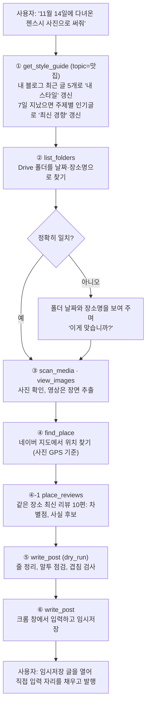

# naverblog-mcp


Google Drive에 올린 사진과 영상으로 Claude가 네이버 블로그 글을 쓰고, **임시저장**까지 해 주는 로컬 MCP 서버입니다.
Claude Desktop에 연결해서 "11월 14일에 다녀온 젠스시 사진으로 써줘"처럼 말하면 됩니다. 발행은 사람이 직접 합니다.

- 🔐 비밀번호를 저장하지 않습니다. 브라우저 창에서 한 번 로그인하면 그 쿠키를 재사용합니다.
- 👀 브라우저 작업(최근 글 읽기, 장소 검색, 글 입력)이 모두 화면에 보이는 크롬 창에서 진행됩니다.
- 🧑‍🍳 네이버 맛집, 여행 상위 블로그 48편을 분석한 형식으로 씁니다: 한 줄 한 호흡, 가운데 정렬, 짧은 소제목, 지도와 정보 줄은 글 앞쪽.
- ✍️ 맛 평가, 외관 후기, 느낀 점은 비워 두고 `[이 부분에 직접 입력하시기 바랍니다]`와 고를 수 있는 추천 문구를 남깁니다.
- 🛑 발행 버튼은 코드에서 막혀 있습니다. 결과물은 항상 임시저장입니다.

<br>

## 동작 흐름



<br>

## 도구

| 도구 | 하는 일 |
|---|---|
| `get_style_guide` | 내 블로그 최근 게시물(최대 5개)로 '내 스타일'을 만들고, 글 주제의 '최신 경향'이 7일 지났으면 다시 분석한 뒤 기본 가이드와 합쳐 돌려줌. 글을 쓸 때마다 가장 먼저 호출 |
| `place_reviews` | 같은 장소에 지도를 첨부한 최신 블로그 리뷰 10편 분석: 형식, 많이 다룬 내용과 덜 다룬 내용, 최근 리뷰 2곳 이상이 같은 가격 같은 사실 후보. 문장은 돌려주지 않고 겹침 검사에만 사용 |
| `refresh_trends` | 네이버 주제별 인기글과 최신글 15편의 형식 수치로 '최신 경향'을 다시 만듦. 보통은 `get_style_guide`가 7일마다 자동으로 함 |
| `recent_posts` | 겹침 비교 대상: 내 블로그 최근 게시물과 아직 발행 전인 임시저장 기록 |
| `list_folders` | 사용자가 말한 날짜와 장소로 사진 폴더 찾기. 날짜 형식 무관, 장소명 오타 허용, 애매하면 확인 질문 |
| `scan_media` | 폴더의 사진과 영상 목록, 촬영 시각, GPS, 해상도, 영상 길이 |
| `view_images` | 사진을 축소해 Claude가 직접 보게 함 (한 번에 10장, 응답 크기 자동 조절) |
| `extract_video_frames` | 영상에서 장면을 뽑아 보여 줌. 뽑은 장면은 본문 사진으로 사용 가능 |
| `find_place` | 네이버 지도에서 장소 검색. 사진 GPS에서 가장 가까운 지점의 주소, 업종, 전화번호와 지도 블록 정보 |
| `load_research` / `save_research` | `/research` 결과 노트 조회와 저장 |
| `write_post` | 제목과 블록(글, 직접 입력 자리와 추천 문구, 소제목, 마무리 상자, 구분선, 사진, 지도)을 가운데 정렬로 입력하고 임시저장. 장소 글은 같은 장소 리뷰를 먼저 읽어야 저장. 저장 완료를 확인한 뒤 보고 |
| `check_setup` | 설치와 설정 점검 |
| `login_status` / `open_login_window` | 로그인 상태 확인, 직접 로그인할 창 열기 |
| `inspect_editor` | 글쓰기 화면의 셀렉터 진단 (입력과 저장 없음) |

**프롬프트** (Claude Desktop 입력창의 `+` 메뉴)

| 프롬프트 | 입력 | 하는 일 |
|---|---|---|
| `/write` | 폴더 또는 주제, 제목, 큰 틀, 메모 (모두 선택) | 스타일 가이드대로 초안을 써서 임시저장 |
| `/research` | 주제, 기간(기본 3개월) | 출처 5개 이상, 광고 제외로 사실을 정리해 노트로 저장 |

<br>

## 안전장치

| 항목 | 동작 |
|---|---|
| 발행 차단 | 자동화 브라우저 안의 발행 버튼 클릭을 페이지와 코드 두 겹으로 차단 |
| 폴더 확인 | 날짜나 장소명이 정확히 맞지 않으면 "이게 맞습니까?" 확인 전에는 사진을 읽지 않음 |
| 사실 규칙 | 폴더 이름, 메모, 사진 속 글자, 네이버 지도 결과, 리서치 노트만 사실로 사용. 모르는 값은 `[[확인필요]]` |
| 주관 평가 | 맛, 외관, 분위기, 느낀 점, 추천은 `[이 부분에 직접 입력하시기 바랍니다]` + `(추천 문구)` 줄 |
| 말투 점검 | 마침표만 이어지는 줄, 같은 어미 반복, 촬영 시각(분 단위), 40자 넘는 줄, 질문형 소제목 남용을 저장 전에 경고 |
| 겹침 검사 | 최근 글과 제목, 키워드, 소제목, 도입과 마무리, 반복 문장이 겹치면 경고. 같은 장소의 다른 사람 리뷰와 거의 같은 문장은 한 문장부터 경고 |
| 다른 블로그 | 같은 장소 리뷰와 주제별 인기글은 형식 수치와 짧은 정보 줄만 사용. 본문은 Claude에게 보내지 않고, 겹침 검사용 본문은 24시간 뒤 삭제. `READ_OTHER_BLOGS=false`로 끔 |
| 저장 확인 | 저장 완료 신호(알림, 저장 글 수, 저장 응답)를 확인한 뒤에만 성공으로 보고 |
| 위치 정보 | 업로드하는 사진에서 GPS 정보 제거 (`STRIP_GPS`) |
| 사용량 | 하루 임시저장 2건(`DAILY_DRAFT_LIMIT`), 같은 글 60분 내 재저장 금지, 글당 사진 30장 |
| 파일 접근 | `MEDIA_ROOTS` 밖의 파일은 읽지도 올리지도 않음 |

<br>

## 프로젝트 구조

```
naverblog-mcp/
├── src/naver_blog_writer/
│   ├── server.py              # MCP 서버 생성, 작업 순서 안내, 도구 등록
│   ├── config.py              # 환경 변수와 .env 설정
│   ├── login_cli.py           # 터미널 로그인 도우미
│   ├── tools/                 # MCP 도구 (파일 1개 = 도구 1개)
│   │   ├── get_style_guide.py  recent_posts.py  list_folders.py  scan_media.py
│   │   ├── view_images.py  extract_video_frames.py  find_place.py  place_reviews.py  write_post.py
│   │   ├── load_research.py  save_research.py  refresh_trends.py  check_setup.py
│   │   └── login_status.py  open_login_window.py  inspect_editor.py
│   ├── prompts/               # /write, /research
│   └── core/
│       ├── dates.py           # 날짜 표현 해석
│       ├── folders.py         # 폴더 찾기, 오타 비교, 확인 질문
│       ├── media.py           # EXIF, 미리보기, HEIC 변환, GPS 제거, 영상 장면
│       ├── place.py           # 네이버 지도 장소 검색
│       ├── blog_reader.py     # 내 블로그 최근 글 읽기, 내 스타일 생성
│       ├── post_analysis.py   # 다른 사람 글의 형식 분석과 집계
│       ├── place_reviews.py   # 같은 장소 최신 리뷰 (24시간 캐시, 겹침 검사)
│       ├── trends.py          # 주제별 인기글 최신 경향 (7일 캐시)
│       ├── browser.py         # 브라우저 세션, 로그인, 발행 차단 가드
│       ├── editor.py          # SmartEditor ONE 조작
│       ├── selectors.py       # 에디터 셀렉터 모음
│       ├── formatting.py      # 한 줄 한 호흡 정리, 점검(lint), 직접 입력 자리와 추천 문구
│       ├── archive.py         # 겹침 검사
│       └── history.py  notes.py  style.py
├── style/default.md           # 기본 글쓰기 스타일 가이드
├── style/style_guide.md       # 개인 고정 규칙 (비어 있는 틀, 직접 채움)
├── tests/                     # 네이버 접속 없이 도는 테스트와 가짜 에디터
├── pyproject.toml  uv.lock
└── CLAUDE.md                  # Claude Code용 개발 규칙
```

<br>

## 설치

### 준비물

- [uv](https://docs.astral.sh/uv/): 파이썬 패키지 관리 도구. 맞는 버전의 Python(3.10 이상)이 없으면 uv가 알아서 받습니다.
  - macOS: `brew install uv` 또는 `curl -LsSf https://astral.sh/uv/install.sh | sh`
  - Windows PowerShell: `powershell -ExecutionPolicy ByPass -c "irm https://astral.sh/uv/install.ps1 | iex"`
- Google Chrome (없으면 아래 '설치하기'의 Chromium 설치를 따릅니다)
- [Google Drive for desktop](https://www.google.com/drive/download/)
- [Claude Desktop](https://claude.ai/download)

### 설치하기

```bash
git clone https://github.com/yoonwanggyu/naverblog-mcp.git
cd naverblog-mcp
uv sync          # .venv 가상환경을 만들고 필요한 패키지를 설치
```

- 의존성은 `requirements.txt` 대신 `pyproject.toml`(패키지 목록)과 `uv.lock`(정확한 버전)에 들어 있습니다. `uv sync` 한 줄이 `.venv`를 만들고 `uv.lock`과 똑같은 버전으로 설치합니다.
- `.venv`는 컴퓨터마다 `uv sync`로 새로 만듭니다. 레포에는 올리지 않습니다.
- Chrome이 없으면 Playwright 전용 Chromium을 설치하고, 아래 `.env`의 `BROWSER_CHANNEL`을 비워 둡니다.

  ```bash
  uv run playwright install chromium
  ```

<details>
<summary>uv 없이 pip으로 설치하기</summary>

```bash
python3 -m venv .venv
source .venv/bin/activate          # Windows: .venv\Scripts\activate
pip install -e .                   # pyproject.toml의 패키지를 설치 (버전은 uv.lock과 다를 수 있음)
```

이 경우 Claude Desktop 설정의 `command`에는 uv 대신 `<레포 경로>/.venv/bin/naver-blog-writer`(Windows `.venv\Scripts\naver-blog-writer.exe`)를 쓰고 `args`는 비웁니다.
</details>

### 설정하기 (`.env`)

레포 최상단(`pyproject.toml`이 있는 폴더)에 `.env` 파일을 만듭니다. API 키는 필요 없고, `.env`는 레포에 올라가지 않습니다.

```bash
touch .env          # 빈 파일 만들기 (Windows PowerShell: New-Item .env)
open -e .env        # 텍스트 편집기로 열기 (VS Code라면 code .env)
```

macOS Finder에서는 `.`으로 시작하는 파일이 숨겨져 있습니다. `Command + Shift + .`을 누르면 보입니다. 아래 내용을 붙여 넣고 값을 채웁니다.

```dotenv
# 블로그 주소 https://blog.naver.com/<여기> 부분
NAVER_BLOG_ID=myblogid

# Google Drive for desktop의 블로그 사진 폴더 (여러 개면 macOS ':', Windows ';'로 연결)
MEDIA_ROOTS=/Users/<사용자>/Library/CloudStorage/GoogleDrive-<이메일>/내 드라이브/네이버블로그

# 브라우저 (Chrome이 없으면 비워 둠). Claude Desktop 설정과 같은 값으로 맞춰야 로그인이 공유됩니다
BROWSER_CHANNEL=chrome
HEADLESS=false

# 하루 임시저장 한도
DAILY_DRAFT_LIMIT=2

# 개인 고정 규칙 파일 (선택). style/style_guide.md를 채운 뒤 이 줄을 넣으면 모든 글에 적용됩니다
STYLE_GUIDE_PATH=style/style_guide.md
```

- 한 줄에 `이름=값` 하나씩 씁니다. `#`으로 시작하는 줄은 주석입니다.
- 블로그 ID는 내 블로그를 열었을 때 주소창의 `blog.naver.com/` 뒷부분입니다.
- Drive 폴더 경로는 Finder에서 폴더를 선택하고 `Option + Command + C`로 복사합니다. 경로에 공백이 있어도 따옴표 없이 그대로 씁니다. Windows는 보통 `G:\내 드라이브\네이버블로그`입니다.
- `STYLE_GUIDE_PATH`는 상대 경로면 레포 폴더 기준입니다. 채우는 방법은 [개인 고정 규칙](#개인-고정-규칙-stylestyle_guidemd)을 봅니다.
- 그 밖의 설정은 [환경 변수](#환경-변수) 표의 이름 그대로 추가합니다.
- Claude Desktop 설정의 `env`에 같은 값을 넣으면 그쪽이 우선합니다.

### 설치 확인

```bash
BROWSER_CHANNEL=chrome uv run python tests/mock_editor_test.py
```

모든 항목이 `PASS`면 정상입니다. 전체 테스트는 [테스트](#테스트)를 참고하세요.

<br>

## Claude Desktop 연결

Claude Desktop에서 **설정 → 개발자 → 구성 편집**을 누르면 `claude_desktop_config.json`이 열립니다.
직접 열 때의 위치는 macOS `~/Library/Application Support/Claude/claude_desktop_config.json`, Windows `%APPDATA%\Claude\claude_desktop_config.json`입니다.

레포에 `.env`를 만들었다면 아래처럼 `command`와 `args`만 있으면 됩니다.

```json
{
  "mcpServers": {
    "naver-blog": {
      "command": "/opt/homebrew/bin/uv",
      "args": ["--directory", "/Users/<사용자>/naverblog-mcp", "run", "naver-blog-writer"]
    }
  }
}
```

`.env` 대신 설정 파일에 값을 직접 넣으려면 `env` 항목을 함께 씁니다.

<details open>
<summary><b>macOS</b></summary>

```json
{
  "mcpServers": {
    "naver-blog": {
      "command": "/opt/homebrew/bin/uv",
      "args": ["--directory", "/Users/<사용자>/naverblog-mcp", "run", "naver-blog-writer"],
      "env": {
        "NAVER_BLOG_ID": "<블로그 ID>",
        "MEDIA_ROOTS": "/Users/<사용자>/Library/CloudStorage/GoogleDrive-<이메일>/내 드라이브/네이버블로그",
        "BROWSER_CHANNEL": "chrome",
        "HEADLESS": "false"
      }
    }
  }
}
```
</details>

<details>
<summary><b>Windows</b></summary>

```json
{
  "mcpServers": {
    "naver-blog": {
      "command": "uv",
      "args": ["--directory", "C:\\Users\\<사용자>\\naverblog-mcp", "run", "naver-blog-writer"],
      "env": {
        "NAVER_BLOG_ID": "<블로그 ID>",
        "MEDIA_ROOTS": "G:\\내 드라이브\\네이버블로그",
        "BROWSER_CHANNEL": "chrome",
        "HEADLESS": "false",
        "PYTHONIOENCODING": "utf-8"
      }
    }
  }
}
```
</details>

- 파일에 이미 다른 내용(`preferences`, 다른 MCP 서버 등)이 있으면 지우지 말고, `mcpServers` 안에 `"naver-blog": { ... }` 항목만 추가합니다. 항목 사이에는 쉼표(`,`)를 넣습니다.

  ```json
  {
    "mcpServers": {
      "기존-서버": { "...": "..." },
      "naver-blog": { "command": "...", "args": ["..."] }
    },
    "preferences": { "...": "..." }
  }
  ```
- `command`에는 uv의 전체 경로를 씁니다(macOS `which uv`, Windows `where uv`).
- `--directory`에는 레포의 절대 경로를 씁니다.
- 레포에 `.env`가 있으면 `env` 항목은 생략해도 됩니다.
- Claude Desktop에서 처음 사진 폴더를 읽을 때 macOS가 Google Drive 접근 권한을 물으면 허용합니다.
- 저장한 뒤 Claude Desktop을 완전히 종료(`Cmd + Q`)했다가 다시 실행합니다.
- 연결 확인: **설정 → 개발자**에서 `naver-blog`에 오류 표시가 없고, 새 대화에서 "설치 점검해줘"라고 했을 때 `check_setup` 결과가 나오면 연결된 것입니다. 이어서 [처음 사용하기](#처음-사용하기)를 따릅니다.
- 다른 MCP 서버와 함께 연결해도 됩니다. 다만 다른 브라우저 자동화 MCP(예: Playwright MCP)가 켜져 있으면 Claude가 그쪽으로 네이버를 조작하려 할 수 있으니, 블로그 작업 중에는 꺼 두기를 권장합니다.

**코드를 고쳤을 때**

| 바꾼 것 | 반영 방법 |
|---|---|
| `.py` 코드, 도구 설명 | Claude Desktop 재시작 후 새 대화 |
| `style/default.md`, `style/style_guide.md` | 바로 반영 (호출할 때마다 읽음) |
| `env` 값, 의존성 | Claude Desktop 재시작 |

<br>

## 처음 사용하기

1. **설치 점검**: Claude에게 "설치 점검해줘" → `check_setup`에서 로그인 외 항목이 모두 ok인지 확인
2. **로그인**: "네이버 로그인 창 열어줘" → 뜬 창에서 직접 로그인('로그인 상태 유지' 체크)
   - 터미널에서는 `uv run naver-blog-login`
   - 로그인 쿠키는 `~/.naver-blog-writer/browser-profile`에 저장되어 터미널과 Claude Desktop이 같이 씁니다.
3. **로그인 확인**: "로그인 상태 확인해줘" → `logged_in: true`
4. **에디터 진단**: "inspect_editor로 에디터 진단해줘" → `selectors`의 숫자가 대부분 1 이상인지 확인. 0인 항목은 `core/selectors.py`에서 수정
5. **테스트 글**: 사진 3장 정도로 임시저장 → 결과의 `verify.ok`와 `saved_confirmed`가 `true`인지, 창에서 제목, 문단, 인용구, 사진, 지도 순서가 맞는지 확인
6. **정리**: 네이버 글쓰기 화면의 '저장' 목록에서 테스트 글 삭제

<br>

## 사용법

### 사진 폴더

장소명과 날짜만 있으면 폴더 이름 형식은 자유입니다.

```
네이버블로그/
├── 젠스시(26.11.14)/          # 26.11.14 · 2026-11-14 · 20261114 · 11월 14일 · 11.14 모두 인식
├── 2026-11-15_성수데이트/
│   ├── 1_카페어니언/          # 하루 여러 곳은 하위 폴더, 앞 숫자가 방문 순서
│   └── 2_OO국밥/
└── 웨딩홀투어/                # 날짜가 없으면 첫 사진의 촬영일 사용
```

### 요청하기

경로는 필요 없고, '블로그'라는 말이 없어도 됩니다.

```
11월 14일에 다녀온 젠스시 사진으로 써줘.
```

날짜나 이름이 정확히 맞지 않으면 이렇게 확인합니다.

```
말씀하신 '11월24일에 다녀온 제스시'와 정확히 같은 폴더는 없지만, 가장 비슷한 폴더를 찾았습니다.

- 폴더 이름: 젠스시(26.11.14)
- 폴더에 저장된 날짜: 2026년 11월 14일
- 장소(식당) 이름: 젠스시

다른 점:
- 날짜: 말씀하신 11월 24일 → 폴더에는 2026년 11월 14일
- 이름: 말씀하신 '제스시' → 폴더에는 '젠스시'

이게 맞습니까?
```

제목이나 큰 틀을 정하고 싶으면 `+` 메뉴에서 `/write`를 고릅니다. 가격이나 일정처럼 확인이 필요한 정보는 `/research`로 먼저 정리해 두면 글에 쓰입니다.

### 발행 전에 할 일

1. 평소 쓰는 브라우저에서 네이버 글쓰기 화면의 '저장' 목록을 엽니다.
2. `[이 부분에 직접 입력하시기 바랍니다]` 자리에 맛 평가, 외관 후기, 느낀 점을 씁니다. 바로 아래 `(추천 문구)` 줄은 마음에 드는 것을 고쳐 쓰거나 지웁니다(머리말 `(추천 문구)`도 지웁니다).
3. 추천 문구 속 메뉴 이름(예: 후토마키)은 사진으로 짐작한 이름이니 실제 메뉴와 맞는지 확인합니다.
4. `[[확인필요: 항목]]`을 확인해 고칩니다.
5. 협찬받은 글이면 제목의 '내돈내산'을 지우고 협찬 표기가 맨 앞에 있는지 확인합니다.
6. 카테고리를 고르고 발행합니다.

<br>

## 스타일 가이드

글은 아래 자료를 모두 읽고 종합해서 씁니다. 자료끼리 부딪쳐 둘 다 지킬 수 없을 때만 우선순위를 따릅니다(`default.md` 0절).

| 우선순위 | 자료 | 언제 |
|---|---|---|
| 0 | 바꿀 수 없는 규칙: 발행 금지, 하루 한도, 사실 지어내지 않기, 다른 사람 글 문장 금지, 협찬 표기 | 항상 |
| 1 | 이번 요청 (Claude Desktop에 입력한 문장과 메모) | 매번 |
| 2 | 개인 고정 규칙 `style/style_guide.md` | 매번 (비어 있으면 없음) |
| 3 | 내 스타일: 내 블로그 최근 글 5개 | 매번 새로 읽음 |
| 4 | 같은 장소 리뷰 10편 (`place_reviews`) | 장소 글이면 장소마다 반드시 |
| 5 | 최신 경향: 주제별 인기글 15편 | 매번 적용, 7일마다 다시 분석 |
| 6 | 기본 가이드 `style/default.md` | 매번 |

파일 기준으로는 아래 네 가지가 합쳐져 한 가이드가 됩니다.

| 합치는 순서 | 파일 | 내용 |
|---|---|---|
| 1 | `style/default.md` | 기본 규칙: 사실 규칙, 추천 문구 패턴, 말투, 줄과 묶음, 소제목, 제목, 구성, 분량, 사진 배치, 협찬 표기. 부록에 상위 블로그 분석 수치 |
| 1-1 | `~/.naver-blog-writer/trends/` | 최신 경향(부록 B): 네이버 주제별 인기글 15편의 형식 수치, 7일마다 자동 갱신 |
| 2 | `~/.naver-blog-writer/my_style.md` | 내 스타일: 글을 쓸 때마다 내 블로그 최근 게시물 5개로 자동 생성 (분량, 사진 수, 소제목, 문장 끝 표현, 한 줄 길이, 정렬, 본문) |
| 3 | `style/style_guide.md` (`STYLE_GUIDE_PATH`) | 개인 고정 규칙 (선택): 내가 직접 적는 규칙. 가장 우선 |

- 게시물이 5개보다 적으면 있는 만큼, 없으면 기본 규칙만 씁니다.
- 기본 규칙의 사실 규칙과 직접 입력 자리 규칙은 항상 지킵니다.

### 개인 고정 규칙 (`style/style_guide.md`)

`default.md`는 레포 코드라 업데이트할 때 덮어써지고, `my_style.md`는 글을 쓸 때마다 자동으로 새로 만들어집니다.
"앞으로 항상 이렇게 써 줘" 같은 나만의 규칙은 `style/style_guide.md`에 적습니다.

1. `style/style_guide.md`를 열고 맨 아래 `## 규칙` 밑에 한 줄에 하나씩 적습니다.
   ```markdown
   ## 규칙
   - 인사는 항상 "안녕하세요, ○○이에요 :)"로 시작
   - 남자친구는 '오빠'라고 부름
   - 마무리 상자는 포스트잇 모양만 사용
   - 태그에 #커플데이트 항상 포함
   ```
2. `.env`에 `STYLE_GUIDE_PATH=style/style_guide.md`를 추가합니다(처음 한 번만, 그 뒤 Claude Desktop 재시작).
3. 이후에는 파일만 고치면 다음 글부터 바로 반영됩니다.

- 파일 맨 위 주석(`<!-- -->`) 안의 설명과 예시는 Claude에게 전달되지 않습니다. 주석 밖이 비어 있으면 아무 영향이 없습니다.
- 사실 규칙, 다른 사람 글 문장 금지, 협찬 표기, 발행 금지는 이 파일로 바꿀 수 없습니다.
- 이 파일은 레포에 포함된 틀입니다. 내 규칙을 GitHub에 올리고 싶지 않으면 커밋하지 않거나, 레포 밖 파일을 만들고 그 경로를 `STYLE_GUIDE_PATH`에 적습니다.

<br>

## 환경 변수

| 변수 | 기본값 | 설명 |
|---|---|---|
| `NAVER_BLOG_ID` | (필수) | 블로그 ID |
| `MEDIA_ROOTS` | (필수) | 사진 폴더. 여러 개면 macOS `:`, Windows `;` |
| `BROWSER_CHANNEL` | 비어 있음 | `chrome` 또는 `msedge`. 비우면 Playwright Chromium (`uv run playwright install chromium` 필요) |
| `HEADLESS` | `false` | 브라우저 창 숨김. `true`면 장소 지도 첨부가 실패해 `📍 장소명` 자리 표시로 들어감 |
| `DAILY_DRAFT_LIMIT` | `2` | 하루 임시저장 최대 건수 |
| `STYLE_GUIDE_PATH` | 비어 있음 | 개인 고정 규칙 파일. 보통 `style/style_guide.md` (상대 경로는 레포 기준) |
| `RECENT_POSTS_LIMIT` | `5` | 글을 쓸 때마다 읽는 최근 게시물 수 |
| `READ_OTHER_BLOGS` | `true` | 다른 사람 블로그 읽기(같은 장소 리뷰, 주제별 인기글 경향). `false`면 내 글 5편과 기본 가이드만 씀 |
| `TREND_MAX_AGE_DAYS` | `7` | 최신 경향을 다시 분석하는 주기(일) |
| `TREND_POSTS` | `15` | 최신 경향 분석에 읽는 글 수 |
| `PLACE_REVIEWS_LIMIT` | `10` | 같은 장소 리뷰를 읽는 수 |
| `STYLE_SYNC_MAX_AGE_MIN` | `180` | 최근 게시물을 읽은 지 이 시간(분)이 지나면 `write_post`가 `get_style_guide`부터 요구 |
| `STRIP_GPS` | `true` | 업로드 전 사진의 GPS 정보 제거 |
| `TYPING_MODE` | `insert` | 글자가 빠지면 `type`(한 글자씩 입력) |
| `TEXT_ALIGN` | `center` | 본문 정렬. `left`, `center`, `right`, `justify` |
| `SUBTITLE_STYLE` | `quotation_line` | 소제목 인용구 모양. `quotation_underline`, `default`, `quotation_bubble`, `quotation_postit`, `quotation_corner` |
| `PREVIEW_BUDGET_BYTES` | `900000` | `view_images` 한 번의 응답 크기 상한 |
| `SAVE_CONFIRM_TIMEOUT_S` | `15` | 저장 완료 신호를 기다리는 시간(초) |
| `DUPLICATE_WINDOW_MIN` | `60` | 같은 글 재저장 금지 시간(분) |
| `MAX_IMAGES_PER_POST` | `30` | 글당 최대 사진 수 |
| `RETURN_ERROR_SCREENSHOT` | `false` | 실패 스크린샷을 Claude에게 이미지로 반환 |
| `NBW_HOME` | `~/.naver-blog-writer` | 브라우저 프로필, 캐시, 로그, 내 스타일 저장 위치 |
| `SLOW_MO_MS` | `0` | 브라우저 동작 사이 지연(ms) |

<br>

## 테스트

네이버에 접속하지 않습니다.

```bash
BROWSER_CHANNEL=chrome uv run python tests/mock_editor_test.py   # 가짜 에디터: 입력, 정렬, 굵게, 인용구 모양, 업로드, 장소, 저장 확인, 발행 차단
uv run python tests/folders_test.py                              # 폴더 찾기: 날짜 형식, 오타, 확인 질문
BROWSER_CHANNEL=chrome uv run python tests/place_blog_test.py    # 장소 데이터, 내 스타일, 같은 장소 리뷰, 최신 경향
uv run python tests/archive_test.py                              # 겹침 검사
uv run python tests/formatting_test.py                           # 한 줄 한 호흡 정리, 추천 문구, 말투 점검
uvx ruff check src tests
```

<br>

## 문제 해결

| 증상 | 해결 |
|---|---|
| Claude에 도구가 안 보임 | 설정 JSON 문법, uv 전체 경로, `--directory` 절대 경로 확인 후 앱 완전 재시작. 로그: macOS `~/Library/Logs/Claude`, Windows `%APPDATA%\Claude\logs` |
| 브라우저 창이 안 보임 | `HEADLESS=false`인지 확인. 로그인 전이면 글쓰기 단계가 바로 끝나므로 먼저 "네이버 로그인 창 열어줘"로 로그인 |
| 브라우저 프로필 사용 중 | 로그인 창이나 진행 중인 작업 창을 닫고 다시 시도 |
| 로그인이 자주 풀림 | 로그인할 때 '로그인 상태 유지' 체크, `BROWSER_CHANNEL`을 터미널과 Claude Desktop에서 같게 |
| 폴더를 못 찾음 | Drive 동기화가 끝났는지, `MEDIA_ROOTS`가 맞는지 확인. 스트리밍 모드면 폴더를 '오프라인 사용 가능'으로 |
| `saved_confirmed: false` | 네이버 '저장' 목록에서 직접 확인. 저장됐다면 `inspect_editor` 결과로 `SAVE_TOAST`, `SAVE_RESPONSE_URL` 수정 |
| `FAILED`와 스크린샷 | 같은 요청을 반복하지 말고 `~/.naver-blog-writer/errors`의 스크린샷 확인 후 `inspect_editor`로 진단 |
| "작성 중인 글이 있습니다" 창 | 저장하지 않고 편집하다 만 내용이 있으면 뜸. 서버가 창이 뜰 때까지 기다렸다가 '취소'를 눌러 새 글로 시작하고 결과 `notes`에 알림. '저장' 목록의 임시저장 글은 그대로 남고 새 글은 따로 저장됨 |
| 한글이 빠짐 | `TYPING_MODE=type` |

<br>

## 보안과 정책

- `~/.naver-blog-writer/browser-profile`에는 로그인 쿠키가 들어 있습니다. 공유, 동기화, 커밋하지 마세요.
- 블로그 읽기는 아래 세 가지뿐이며, 모두 공개 글을 화면에 보이는 브라우저로 사람이 보는 속도로 읽습니다.

  | 읽는 것 | 양과 주기 | 저장하는 것 | 지우는 때 |
  |---|---|---|---|
  | 내 블로그 최근 글 | 5편, 글을 쓸 때마다 | 제목, 본문, 소제목, 태그 (`my_posts/`, `my_style.md`) | 다음 글을 쓸 때 덮어씀 |
  | 같은 장소의 다른 사람 리뷰 | 장소당 10편, 장소 글을 쓸 때만 | 겹침 검사용 제목, 소제목, 본문 줄 (`place_reviews/`) | 24시간 뒤 자동 삭제 |
  | 네이버 주제별 인기글과 최신글 | 15편, 7일에 한 번 | 형식 수치만. 본문과 글 주소는 저장하지 않음 (`trends/`) | 다음 갱신 때 덮어씀 |

- 다른 사람 글의 본문은 Claude에게 보내지 않습니다. Claude에게는 수치, 제목, 소제목, 60자 이하의 정보 줄(가격, 영업시간 등)만 갑니다. 다른 사람 글의 문장을 내 글에 쓰면 저장 전에 경고합니다.
- 목적은 형식 통계, 사실 후보 확인, 내 글이 다른 글과 겹치지 않게 하는 검사입니다. 수집한 내용을 배포하거나 다른 용도로 쓰지 않습니다.
- 다른 사람 블로그를 읽고 싶지 않으면 `.env`에 `READ_OTHER_BLOGS=false`를 넣습니다. 그러면 내 글 5편과 기본 가이드만으로 씁니다.
- 자동화된 읽기와 임시저장은 네이버 이용약관상 회색 지대일 수 있습니다. 개인 용도로 적은 양만 쓰고, 이용 책임은 사용자에게 있습니다.
- 장소 검색은 사진의 GPS 좌표를 네이버 지도 검색의 중심 위치로 사용합니다. 업로드하는 사진에서는 GPS를 지웁니다.
- 네이버 글쓰기 API는 종료되어 브라우저 자동화 방식만 가능합니다.
- 네이버 운영정책은 허락 없는 자동화로 기계적인 글을 반복 게시하는 행위를 이용제한 사유로 봅니다. 사람이 검토하고 발행하는 방식을 유지하세요.

<br>

## 라이선스

[MIT](LICENSE)
